# Unreal Engine 5 Gameplay Prototypes

Short gameplay-mechanic prototypes built in Unreal Engine 5 (2023): character movement, interaction, combat and level blockout.

## Prototypes

| # | Prototype | Preview | What it shows |
|---|---|---|---|
| 01 | [Grenade Explosion](videos/01-grenade-explosion.mp4) | 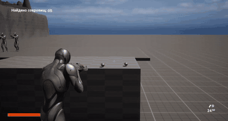 | Throwing a grenade with a trajectory preview and an explosion effect. HUD with treasure counter, health bar and ammo. |
| 02 | [Castle Gate Opens on Hit](videos/02-castle-gate-opens-on-hit.mp4) | 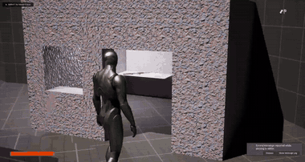 | A gate that opens when the player hits it. |
| 03 | [Note Pickup](videos/03-note-pickup.mp4) | 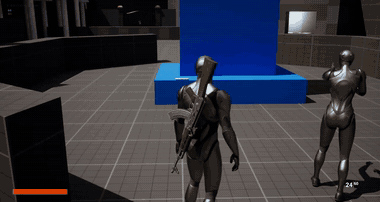 | Interact with a note (`E`) and its text is shown on screen. |
| 04 | [Health Display](videos/04-health-display.mp4) | 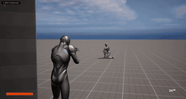 | Health bar on the HUD that updates during combat. |
| 05 | [Crouch and Smooth Turn](videos/05-crouch-and-smooth-turn.mp4) | 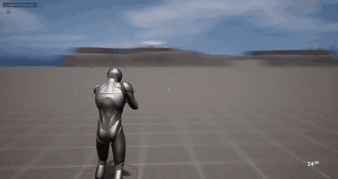 | Crouching and smooth character turning with a rifle (preview sped up). |
| 06 | [Parkour](videos/06-parkour.mp4) | 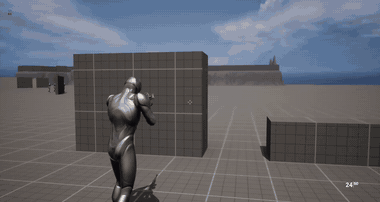 | Traversal over wall obstacles. |
| 07 | [Enemy Bot AI](videos/07-enemy-bot-ai.mp4) | 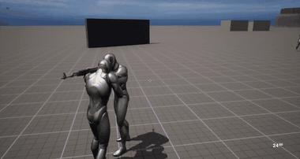 | Enemy bots that engage the player. |
| 08 | [Improved Character Movement](videos/08-improved-character-movement.mp4) | 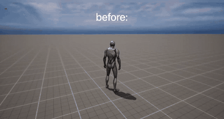 | Before / after comparison of the running animation (preview sped up). |
| 09 | [Gameplay Mechanics Prototype](videos/09-gameplay-mechanics-prototype.mp4) | 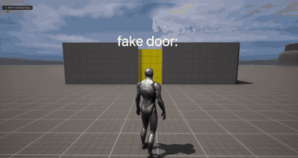 | A "fake door" compared with a "real door" opened with a button (preview sped up). |
| 10 | [Cast Scene Test](videos/10-cast-scene-test.mp4) | 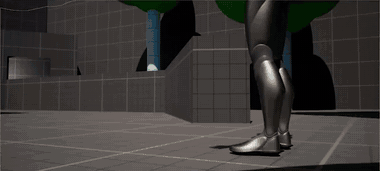 | Cinematic scene test: character animation played back in the engine (cropped to the Unreal Engine viewport, no audio). |

Click a prototype name to open the full video. Long previews are sped up.

## Level blockout

| | |
|---|---|
| 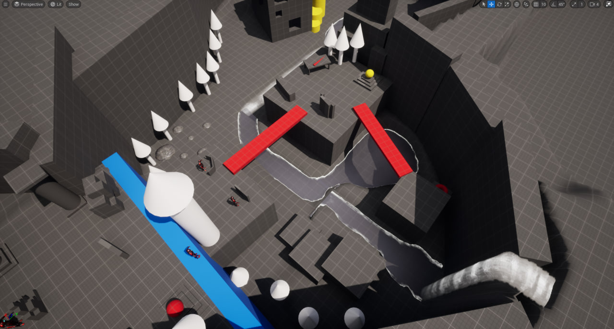 | 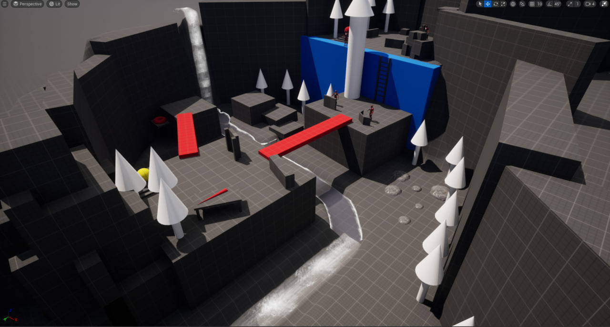 |

## Notes

- Videos are screen recordings from the editor, cropped to remove the taskbar.
- Tools: Unreal Engine 5.
